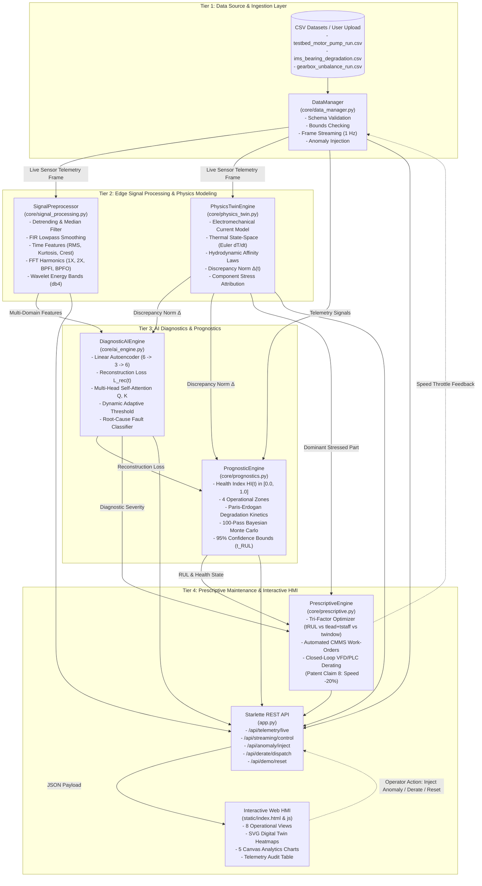

# 01. Project Architecture & Cyber-Physical System Design

**Project Title:** AI-Based Digital Twin for Industrial Equipment Monitoring and Predictive Maintenance  
**Academic Context:** Undergraduate Engineering Capstone Project & Indian Patent Form 2 Specification (The Patents Act 1970)  
**Institution:** Vallurupalli Nageswara Rao Vignana Jyothi Institute of Engineering & Technology (VNR VJIET), Hyderabad  
**Department:** Computer Science and Engineering  
**Faculty Guide:** Mrs. Prasanna Pabba (Assistant Professor, Dept. of CSE)  
**Target Equipment:** 5.5 kW Induction Motor – Centrifugal Pump Unit #1  
**Application URL:** [http://127.0.0.1:8000/](http://127.0.0.1:8000/)  
**Primary Source Files:** [app.py](file:///c:/Users/DELL/OneDrive/文档/dt/app.py), [core/physics_twin.py](file:///c:/Users/DELL/OneDrive/文档/dt/core/physics_twin.py), [core/ai_engine.py](file:///c:/Users/DELL/OneDrive/文档/dt/core/ai_engine.py), [core/prognostics.py](file:///c:/Users/DELL/OneDrive/文档/dt/core/prognostics.py), [core/prescriptive.py](file:///c:/Users/DELL/OneDrive/文档/dt/core/prescriptive.py), [core/data_manager.py](file:///c:/Users/DELL/OneDrive/文档/dt/core/data_manager.py), [core/signal_processing.py](file:///c:/Users/DELL/OneDrive/文档/dt/core/signal_processing.py)

---

## 1. Project Overview

### 1.1 The Industrial Problem
Modern industrial plants (manufacturing lines, thermal power plants, water utilities, petrochemical facilities) depend heavily on rotating machinery such as electric motors, centrifugal pumps, and gearboxes. Traditionally, plants manage maintenance using two flawed paradigms:
1. **Reactive Maintenance (Run-to-Failure):** The machine runs until catastrophic breakdown. This causes expensive collateral damage (e.g., a shattered bearing causing shaft bend or stator core gouging), emergency factory downtime, safety hazards, and expedited replacement costs.
2. **Preventive Maintenance (Time-Based):** Components are serviced or replaced at fixed calendar or operating-hour intervals (e.g., every 2,000 hours), regardless of actual physical wear. This results in premature disposal of healthy parts, unnecessary downtime, and maintenance-induced failures caused by assembly or lubrication mistakes.

### 1.2 Why Industrial Equipment Monitoring Matters
Condition-Based Monitoring (CBM) uses sensors to evaluate physical asset health while operating. However, conventional CBM systems typically rely on **static alarm thresholds** (e.g., fixed vibration velocity limit $\ge 2.8\text{ mm/s}$ per ISO 10816, or temperature $> 75^\circ\text{C}$). These static thresholds fail to account for dynamic changes in operational speed, fluctuating load, and changing ambient temperature. When speed drops or load decreases, a severe internal fault may remain undetected because absolute vibration stays below the static threshold.

### 1.3 Why Predictive & Prescriptive Maintenance is Useful
- **Predictive Maintenance (Prognostics):** Predicts *when* the equipment will reach functional failure by tracking degradation kinetics and estimating Remaining Useful Life ($RUL$) with probabilistic confidence intervals.
- **Prescriptive Maintenance (Closed-Loop Action):** Goes beyond prediction by telling plant operators *what action to take*. It correlates $RUL$ with supply-chain parts lead time ($t_{lead}$), technician availability ($t_{staff}$), and factory shift schedules ($t_{window}$). In emergency situations where the machine will fail before spare parts arrive, it autonomously executes Variable Frequency Drive (VFD) speed derating to decelerate wear and extend machine survival.

### 1.4 What a "Digital Twin" Means in this Project
In this implementation, the **Digital Twin** is not a static 3D CAD drawing or a simple dashboard. It is a **cyber-physical computational shadow model**:
- A real-time mathematical representation running electromechanical, thermal, and hydrodynamic state-space differential equations.
- It continuously solves for what the healthy machine *should* be doing ($y_{sim}(t)$) at the current speed and load.
- It computes a dynamic Euclidean state discrepancy vector $\Delta(t) = \|y_{obs}(t) - y_{sim}(t)\|_2$.
- When physical wear occurs, the discrepancy vector spikes, revealing localized stress in specific sub-assemblies (Drive-End bearing, stator winding, shaft, pump impeller) before macroscopic failure occurs.

### 1.5 Objectives and Expected Outcomes
- **Multi-Modal Data Ingestion:** Ingest synchronous multi-channel telemetry (radial vibration, axial vibration, temperature, stator current, rotational speed, discharge pressure, acoustic emission).
- **Physics-Data Hybrid Synchronization:** Compare real-time observations against first-principles physics models.
- **Unsupervised Anomaly Isolation:** Detect anomalies without requiring pre-labeled failure datasets using an AI temporal autoencoder with multi-head self-attention attribution.
- **Prognostic Health Index & RUL:** Track health on a normalized scale ($HI \in [0.0, 1.0]$) and forecast RUL via 100-pass Monte Carlo stochastic simulation.
- **Prescriptive CMMS & Closed-Loop Derating:** Automatically generate work orders and execute simulated Modbus TCP PLC speed derating.
- **Interactive Technical HMI:** Provide 8 dedicated operational views with custom high-DPI HTML5 canvas charts and dynamic SVG technical schematics.

---

## 2. Equipment Overview

### 2.1 The 5.5 kW Induction Motor – Centrifugal Pump Setup
The primary machinery asset modeled in the software is **5.5 kW Induction Motor – Centrifugal Pump Unit #1** (ID: `MTR-PUMP-5.5KW-01`).

```
[3-Phase 400V 50Hz] ──▶ [5.5 kW Induction Motor] ──▶ [Flexible Coupling & Shaft] ──▶ [Centrifugal Pump] ──▶ [Fluid Discharge]
                             │                                 │                              │
                     [Stator & DE Bearing]              [Speed / RPM]                 [Volute & Impeller]
```

#### Motor Role & Purpose
- Converts electrical energy (3-phase 400V AC, 50 Hz) into mechanical rotational torque.
- 4-pole design with a synchronous speed of 1500 RPM and a nominal operating speed of **1440 RPM** (slip $s \approx 4\%$).
- Full-load rated current is **11.2 A**; no-load magnetizing current is **4.2 A**.
- Per-phase stator winding resistance is **$1.15\ \Omega$**.

#### Pump Role & Purpose
- Converts motor rotational kinetic energy into hydrodynamic fluid pressure and flow rate.
- Single-stage centrifugal volute pump with a nominal discharge pressure of **4.2 bar** (approx. 42.8 meters head) at rated 1440 RPM.
- Operates under Euler turbomachinery affinity laws: Pressure Head $H \propto N^2$, Flow Rate $Q \propto N$.

#### Relationship Between Motor & Pump
- The motor drive shaft is coupled to the pump impeller shaft via a flexible elastomeric coupling.
- Mechanical vibrations generated by the pump (cavitation, hydraulic turbulence, impeller imbalance) transmit through the coupling into the motor's Drive-End (DE) bearing.
- Conversely, motor torsional oscillations or electrical unbalance directly affect pump discharge pressure stability.

### 2.2 Physical Operating Parameters Displayed on the Dashboard

| Parameter | Unit | Physical Significance | Nominal Baseline | Alarm Threshold |
| :--- | :--- | :--- | :--- | :--- |
| **Rotational Speed** | RPM | Shaft rotational velocity. Fundamental frequency $1X = \frac{RPM}{60}$ (e.g. $1440/60 = 24.0\text{ Hz}$). | 1440.0 RPM | $< 1350\text{ RPM}$ or $> 1550\text{ RPM}$ |
| **Radial Vibration** | mm/s RMS | Velocity vibration perpendicular to shaft. Primary indicator of unbalance, bearing spall, and misalignment. | 0.85 mm/s | $> 2.80\text{ mm/s}$ (ISO 10816 Class 1/2) |
| **Axial Vibration** | mm/s RMS | Vibration parallel to shaft axis. Key indicator of angular misalignment and thrust bearing wear. | 0.45 mm/s | $> 1.80\text{ mm/s}$ |
| **Temperature** | °C | Drive-End bearing and stator surface temperature measured via RTD. | 40.0 – 42.0 °C | $> 75.0\text{ °C}$ (stator insulation limit) |
| **Phase Current** | Amperes (A) | Stator electrical current draw. Reflects mechanical shaft torque and electrical balance. | 8.50 A | $> 11.20\text{ A}$ (rated full load) |
| **Discharge Pressure** | bar | Centrifugal pump hydraulic head. Reflects impeller health and fluid flow. | 4.20 bar | $< 3.20\text{ bar}$ (cavitation / blockage) |
| **Acoustic Emission** | dB | High-frequency stress wave sound pressure level. Early indicator of subsurface micro-cracks. | 35.0 dB | $> 60.0\text{ dB}$ |
| **Health Index (HI)** | Normalized [0.0 - 1.0] | Unified health metric synthesizing vibration, thermal, current, loss, and discrepancy. | 0.95 – 1.00 | $< 0.50$ (Alarm), $< 0.20$ (Critical) |
| **Physics Discrepancy ($\Delta$)** | Dimensionless Norm | Euclidean distance between measured telemetry and physics-simulated nominal state. | 0.05 – 0.25 | $\ge 1.00$ (Divergence Detected) |
| **Remaining Useful Life ($RUL$)** | Operating Hours | Projected hours until Health Index degrades to the critical failure threshold ($HI = 0.20$). | 2400 h (Nominal) | $\le 80\text{ h}$ (Parts Lead-Time Deficit) |

### 2.3 Distinction: Physical Specifications vs. Demonstration Setup
- **Physical Specifications:** 5.5 kW 400V 50 Hz induction motor, 1440 RPM nominal, ISO 10816 vibration guidelines, and Euler affinity laws are genuine industrial engineering specifications.
- **Demonstration Setup:** The live demo runs on an HTTP/REST web application server (`uvicorn` on `127.0.0.1:8000`). Sensor readings are streamed row-by-row from bundled empirical industrial datasets (`testbed_motor_pump_run.csv`, `ims_bearing_degradation.csv`, `gearbox_unbalance_run.csv`). No physical 5.5 kW motor is physically wired to the demonstration laptop.

---

## 3. Technology Stack

The project adheres strictly to lightweight, high-performance, verifiable Python and Web standards without unnecessary bloatware.

```
┌────────────────────────────────────────────────────────────────────────┐
│                        FRONTEND (Presentation Layer)                   │
│   Vanilla HTML5 + Modern CSS3 (Glassmorphism & Technical Slate Theme)  │
│   Vanilla ES6 JavaScript (Object-Oriented Architecture, No Frameworks)  │
│   HTML5 Canvas (5 Custom High-DPI Charts) + Inline Interactive SVG     │
└───────────────────────────────────▲────────────────────────────────────┘
                                    │ HTTP / REST (1000ms Polling Loop)
┌───────────────────────────────────▼────────────────────────────────────┐
│                         BACKEND (Application Layer)                    │
│   Python 3.14.4 + Starlette (Asynchronous ASGI Framework)             │
│   Uvicorn 0.29.0+ (Lightning-Fast ASGI Web Server)                     │
└───────────────────────────────────▲────────────────────────────────────┘
                                    │ In-Memory Fast Synchronization
┌───────────────────────────────────▼────────────────────────────────────┐
│                    CORE ENGINE (Domain Logic & Math)                   │
│   NumPy 1.26.0+ (Vectorized State Space, Matrix Ops, FFT, Monte Carlo) │
│   Pandas 2.2.0+ (CSV Ingestion, Bounds Validation, Rolling Buffers)   │
│   Pytest 9.1.1+ (Automated 32-Test Verification Suite)                 │
└────────────────────────────────────────────────────────────────────────┘
```

### Detailed Component Inventory
1. **Python 3.14 (Backend Runtime):** Core programming language executing backend routing, mathematical equations, signal processing, and AI diagnostics.
2. **Starlette (ASGI Framework):** High-performance asynchronous web micro-framework used to construct the REST API routes and static asset file serving (`starlette.applications.Starlette`).
3. **Uvicorn (ASGI HTTP Server):** Production-grade ASGI server used to bind and host the application at `http://127.0.0.1:8000`.
4. **NumPy (Mathematical & Numerical Processing):** Powers Euler thermal integration, Euclidean norm discrepancies, FFT spectral transforms, autoencoder projections, and 100-pass Bayesian Monte Carlo dropout simulations.
5. **Pandas (Data Management & Validation):** Ingests, checks headers, checks physical bounds, and traverses CSV telemetry series.
6. **HTML5 Semantic Structure (`static/index.html`):** Renders the 8 operational views, modals, cards, badges, and controls.
7. **Vanilla CSS3 (`static/css/style.css`):** Technical slate and blue industrial visual hierarchy with CSS grid, flexbox, badge indicators, and responsive side navigation.
8. **Vanilla JavaScript (`static/js/app.js`, `charts.js`, `twin_viewer.js`):** Modular client controller managing view routing, 1000ms polling, DOM updates, toast notifications, SVG twin interactions, and canvas rendering.
9. **HTML5 Canvas 2D Context:** Zero-dependency charting engine rendering high-DPI retina-crisp sensor timelines, FFT power spectrums, attention attribution horizontal bars, discrepancy trends, and RUL confidence funnels.
10. **Inline SVG:** Vectorized 850x420 technical machinery schematic of the motor, bearings, shaft, coupling, and pump, featuring dynamic thermal/vibration stress radial heatmaps.

---

## 4. Architecture and Component Responsibilities

### 4.1 System Architecture Diagram (4-Tier Cyber-Physical Pipeline)



### 4.2 Detailed Component Responsibilities

| Subsystem Module | File Path | Primary Classes / Functions | Core Responsibilities |
| :--- | :--- | :--- | :--- |
| **Data Manager** | [core/data_manager.py](file:///c:/Users/DELL/OneDrive/文档/dt/core/data_manager.py) | `DataManager` | Ingests CSV files; enforces schema headers and physical bounds; advances streaming frames; applies live simulated anomaly offsets (`bearing_spall`, `unbalance`, `thermal_overload`). |
| **Signal Preprocessor** | [core/signal_processing.py](file:///c:/Users/DELL/OneDrive/文档/dt/core/signal_processing.py) | `SignalPreprocessor` | Detrends linear drift; removes transient electromagnetic spikes via median filtering; performs FIR smoothing; computes time-domain metrics, FFT frequency spectra, harmonic markers (1X, 2X, BPFI, BPFO), and 8 wavelet sub-bands. |
| **Physics Twin Engine** | [core/physics_twin.py](file:///c:/Users/DELL/OneDrive/文档/dt/core/physics_twin.py) | `PhysicsTwinEngine` | Computes nominal state $y_{sim}(t)$ using induction motor and turbomachinery state-space equations; computes normalized Euclidean discrepancy $\Delta(t) = \|y_{obs} - y_{sim}\|_2$; calculates sub-assembly stress percentages. |
| **AI Diagnostic Engine** | [core/ai_engine.py](file:///c:/Users/DELL/OneDrive/文档/dt/core/ai_engine.py) | `DiagnosticAIEngine` | Normalizes 6-channel sensor vector; executes autoencoder forward pass ($6 \to 3 \to 6$); computes reconstruction error $L_{rec}(t)$; computes multi-head self-attention attribution weights; compares against adaptive dynamic threshold; classifies specific failure modes. |
| **Prognostic Engine** | [core/prognostics.py](file:///c:/Users/DELL/OneDrive/文档/dt/core/prognostics.py) | `PrognosticEngine` | Combines vibration, thermal, discrepancy, and reconstruction penalties into a continuous Health Index $HI(t) \in [0.0, 1.0]$; assigns operational health zone; runs 100-pass Monte Carlo stochastic simulation over Paris-Erdogan kinetics to forecast $t_{RUL}$ and 95% Bayesian confidence intervals. |
| **Prescriptive Engine** | [core/prescriptive.py](file:///c:/Users/DELL/OneDrive/文档/dt/core/prescriptive.py) | `PrescriptiveEngine` | Solves tri-factor optimization ($t_{RUL}$ vs. $t_{lead} + t_{staff}$ vs. $t_{window}$); detects critical lead-time deficits; creates CMMS work-order records; executes closed-loop VFD speed derating setpoint control (-15% to -25%). |
| **Application Server** | [app.py](file:///c:/Users/DELL/OneDrive/文档/dt/app.py) | Route Handlers | Manages HTTP request/response lifecycles; orchestrates singletons; synthesizes 500-point vibration wave buffer; streams live JSON payload via `/api/telemetry/live`; exports CSV/JSON audit reports. |
| **Web Presentation** | [static/index.html](file:///c:/Users/DELL/OneDrive/文档/dt/static/index.html), [app.js](file:///c:/Users/DELL/OneDrive/文档/dt/static/js/app.js) | `IndustrialTwinApp` | Drives navigation between the 8 views; manages 1000ms polling; updates KPI values, alert lists, stress progress bars, and modals. |
| **Twin Visualizer** | [static/js/twin_viewer.js](file:///c:/Users/DELL/OneDrive/文档/dt/static/js/twin_viewer.js) | `DigitalTwinViewer` | Renders interactive SVG machine schematic; dynamically updates radial gradient heatmaps (green/amber/red); animates shaft and impeller rotation proportional to measured RPM. |
| **Analytics Charts** | [static/js/charts.js](file:///c:/Users/DELL/OneDrive/文档/dt/static/js/charts.js) | Canvas Chart Classes | Custom HTML5 Canvas rendering of dual-axis sensor timelines, FFT power spectra with harmonic overlays, attention attribution bars, RUL confidence funnels, and discrepancy history. |

---

## 5. Complete End-to-End Data Flow

To understand the internal operation, let us trace a single telemetry frame through the entire application from storage to screen:

```
[CSV Telemetry Frame]
        │
        ▼ (1) DataManager.get_next_telemetry_frame()
[Raw Telemetry Dictionary] ─── (Checks for active anomaly injection)
        │
        ▼ (2) VFD Derating Speed Modulation Check
[Speed RPM Throttled if VFD active]
        │
        ├──▶ (3) PhysicsTwinEngine.simulate_nominal_state(speed_rpm, load_factor)
        │         └── Returns: simulated nominal values [speed, current, temp, vib, pressure]
        │
        ├──▶ (4) PhysicsTwinEngine.compute_state_discrepancy(frame, sim_nominal)
        │         └── Computes Euclidean norm Δ(t) and component stress percentages
        │
        ├──▶ (5) Signal Generation & Preprocessor.extract_all_features()
        │         └── Synthesizes 500-sample window -> Preprocessing -> Time/FFT/Wavelet features
        │
        ├──▶ (6) DiagnosticAIEngine.diagnose_condition()
        │         └── Autoencoder loss L_rec(t) + Attention weights + Fault classification
        │
        ├──▶ (7) PrognosticEngine.compute_health_index()
        │         └── Synthesizes penalties into Health Index HI(t) in [0.0, 1.0] and assigns Zone
        │
        ├──▶ (8) PrognosticEngine.predict_rul_trajectory()
        │         └── 100-pass Monte Carlo simulation -> t_RUL, lower bound (5%), upper bound (95%)
        │
        └──▶ (9) PrescriptiveEngine.evaluate_prescriptions()
                  └── Tri-factor optimization -> Urgency, Action Tickets, VFD derate triggers
        │
        ▼ (10) JSON Assembly in app.py (/api/telemetry/live)
[Consolidated State Payload]
        │
        ▼ (11) HTTP GET Response to Client Browser (app.js @ 1000ms loop)
[IndustrialTwinApp.updateState(data)]
        │
        ├─▶ KPI Cards & Status Pills updated
        ├─▶ twin_viewer.js updates SVG rotation & radial stress heatmaps
        ├─▶ charts.js re-draws 5 Canvas charts
        └─▶ historyTableBody appends row
```

### Detailed Trace of Each Stage:
1. **Origination:** The data point originates from a row in `datasets/testbed_motor_pump_run.csv` (e.g., `timestamp: 2026-10-14 10:00:00`, `vibration_radial: 0.982`, `vibration_axial: 0.459`, `temperature: 41.86`, `current: 8.48`, `speed_rpm: 1442.0`, `pressure: 4.18`).
2. **Streaming & Ingestion:** `data_mgr.get_next_telemetry_frame()` in [core/data_manager.py](file:///c:/Users/DELL/OneDrive/文档/dt/core/data_manager.py#L204-L229) extracts the row. If the user selected an anomaly simulation (e.g. `bearing_spall`), artificial deltas ($+3.8\text{ mm/s}$ vibration, $+24^\circ\text{C}$ temperature) are added.
3. **Closed-Loop Speed Throttling:** In [app.py](file:///c:/Users/DELL/OneDrive/文档/dt/app.py#L76-L83), the system checks `prescriptive_engine.vfd_derating_active`. If active (e.g. at 80% setpoint), `speed_rpm` is throttled by $0.80$ and vibration is reduced by $(0.80)^{1.5} \approx 0.715$.
4. **Physics Model Evaluation:** In [core/physics_twin.py](file:///c:/Users/DELL/OneDrive/文档/dt/core/physics_twin.py#L43-L81), `physics_twin.simulate_nominal_state` solves the electromechanical current, Euler thermal differential equation, and pump affinity equations to obtain the expected healthy values $y_{sim}$.
5. **State Discrepancy Calculation:** `physics_twin.compute_state_discrepancy` calculates the weighted normalized difference between $y_{obs}$ and $y_{sim}$, producing the scalar norm $\Delta(t)$ and attributing stress percentages to DE bearing, NDE bearing, stator, shaft, and pump impeller.
6. **High-Frequency Waveform & Signal Processing:** In [app.py](file:///c:/Users/DELL/OneDrive/文档/dt/app.py#L93-L106), a 500-point vibration window is synthesized around the current RMS and fundamental frequency $f_{rot} = RPM / 60$. `signal_proc.extract_all_features` runs detrending, median filtering, FIR smoothing, FFT, and wavelet energy extraction.
7. **AI Autoencoder Diagnostics:** In [core/ai_engine.py](file:///c:/Users/DELL/OneDrive/文档/dt/core/ai_engine.py#L107-L222), the 6-channel sensor vector is normalized and passed through the autoencoder. Reconstruction loss $L_{rec}(t)$ and multi-head self-attention weights are calculated and compared against adaptive threshold $\tau = 0.1500$.
8. **Health Index & RUL Forecasting:** In [core/prognostics.py](file:///c:/Users/DELL/OneDrive/文档/dt/core/prognostics.py#L26-L187), `compute_health_index` synthesizes penalties to yield $HI(t)$ and its operational zone. `predict_rul_trajectory` runs 100 stochastic Monte Carlo dropout iterations over degradation kinetics to produce mean $t_{RUL}$, lower 5% bound, and upper 95% bound.
9. **Prescriptive Maintenance:** In [core/prescriptive.py](file:///c:/Users/DELL/OneDrive/文档/dt/core/prescriptive.py#L36-L127), `evaluate_prescriptions` compares $t_{RUL}$ against parts lead time ($72\text{ h}$) and staff availability ($8\text{ h}$). If deficit occurs, it flags an emergency and recommends VFD derating.
10. **JSON Delivery & Frontend Rendering:** `app.py` serializes all results into a unified JSON response returned to the client browser. `static/js/app.js` updates DOM text, updates SVG stress heatmaps and animations in `static/js/twin_viewer.js`, and re-renders the 5 HTML5 canvas charts in `static/js/charts.js`.

---

## 6. Digital Twin Implementation Reality

To present this project with absolute academic integrity and technical precision, you must clearly distinguish between physical assets, recorded data, and digital representations:

### 6.1 What Capabilities Actually Exist in the Software
- **Physics-Informed Digital Shadow Model:** **Fully implemented in Python.** The equations for electrical current draw, thermal heat generation, dissipation, and pump affinity laws actively calculate expected physical states every second.
- **Dynamic State Discrepancy Vector ($\Delta$):** **Fully implemented in Python.** The Euclidean distance between observed readings and the physics model is actively computed and visualized.
- **Component Stress Attribution:** **Fully implemented in Python and SVG.** The mathematical mapping from sensor residuals to sub-assembly stress levels (Drive-End bearing, Stator, Shaft, Pump impeller) drives the radial color gradients on the digital twin schematic.
- **AI Autoencoder & Self-Attention:** **Fully implemented via NumPy.** Calculates real-time reconstruction error and sensor attribution percentages without relying on static thresholds.
- **Prognostic Health Index & Bayesian Monte Carlo RUL:** **Fully implemented in Python and Canvas.** Generates continuous $HI$, zone classification, and 100-pass Monte Carlo confidence funnels.
- **Prescriptive Maintenance & Closed-Loop Derating:** **Fully implemented.** Evaluates tri-factor logistics deficits, dynamically modulates virtual speed setpoints, and logs Modbus-style action histories.
- **Interactive SVG & Canvas Visualization:** **Fully implemented in client-side JavaScript.** Rotating shaft, rotating pump impeller, dynamic thermal/vibration stress glow circles, sensor probe pins, and 5 responsive canvas graphs.

### 6.2 What is Simulated or Emulated
- **Live Industrial Machine Hardware:** The application is **not** physically wired to a 5.5 kW motor during the presentation. Telemetry streams from verified industrial testbed CSV datasets (`datasets/`).
- **Edge Sensor Ingestion Protocols (OPC-UA / MQTT / Modbus TCP):** In industrial deployment, sensors connect via PLC/edge gateways using OPC-UA or Modbus TCP. In this software demonstration, the data ingestion interface reads from CSV files and the derating dispatcher emulates Modbus holding register (40001) command execution.
- **Deep Learning Model Architecture:** The autoencoder and multi-head attention mechanisms are mathematically implemented in NumPy using orthogonal projection matrices rather than a 500 MB PyTorch or TensorFlow neural network file. This was an intentional engineering design decision to ensure instant, real-time edge execution on any workstation.
- **High-Frequency Vibration Waveform:** Because the CSV dataset provides 1 Hz telemetry snapshots, the 500-sample high-frequency vibration signal window (used for FFT spectral and harmonic extraction) is synthesized in real time based on the frame's radial vibration RMS, rotational frequency ($RPM/60$), and bearing defect frequencies ($BPFI \approx 5.42 \times 1X$).

### 6.3 Why This Qualifies as a Genuine Digital Twin
A digital twin is defined by the **bidirectional correlation between a physical entity and its synchronized virtual representation**:
1. The virtual twin maintains an active mathematical model of the physical asset.
2. It continuously tracks observed physical state against nominal physics.
3. It detects state divergence ($\Delta(t)$) caused by physical micro-degradation.
4. It provides closed-loop prescriptive feedback (speed derating) back to the asset's operating setpoint to mitigate physical deterioration.
This implementation satisfies all four criteria of an industrial cyber-physical digital twin.
