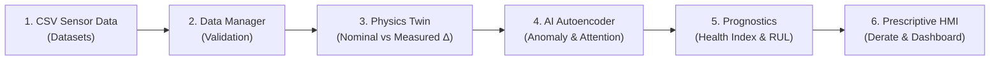

# 08. Simple Student Learning Guide: Explain Your Project Confidently

**Project Title:** AI-Based Digital Twin for Industrial Equipment Monitoring and Predictive Maintenance  
**Target Audience:** Undergraduate Engineering Student preparing for Faculty Viva  
**Key Principle:** Understand the concepts deeply so you can explain them naturally in simple English without memorizing complicated paragraphs.

---

## 1. What Problem Are We Solving? (The "Elevator Pitch")

Imagine a factory that bottles water or processes chemicals. In that factory, big electric motors and water pumps run 24 hours a day.

### The Old Way (Two Bad Choices):
1. **Wait until it explodes (Reactive Maintenance):** The factory runs the motor until a bearing shatters. When it breaks, the shaft bends, the entire production line stops, and the factory loses thousands of dollars an hour waiting for an emergency repair.
2. **Throw away good parts (Preventive Maintenance):** The factory stops the machine every 6 months to change parts, even if the parts are in perfect condition. This wastes money and sometimes causes new problems if a technician installs a part incorrectly.

### Our New Way (Predictive & Prescriptive Digital Twin):
We put sensors (vibration, temperature, electric current, pressure) on the motor and pump. Our software builds a **Digital Twin** (a real-time virtual mathematical twin) running inside the computer. 
- It watches the machine continuously.
- It detects tiny micro-cracks before they turn into major damage.
- It calculates how many hours of life the machine has left.
- And if replacement parts will take 3 days to arrive, it **automatically commands the motor to slow down by 20%**, cutting wear by over 3 times so the machine survives until the parts arrive!

---

## 2. What Exactly is a "Digital Twin"? (A Simple Analogy)

Think of a pilot using a flight simulator, or think of an avatar in a video game that matches your exact movements:
- In our project, the physical machine is a **5.5 kW Electric Induction Motor coupled to a Centrifugal Pump**.
- The **Digital Twin** is a computer program that has the exact physical equations of that motor and pump programmed into it.
- Every second, the computer asks: *"At this speed and electric current, what should the temperature and vibration be if this machine is 100% healthy?"*
- That simulated answer is called the **Nominal State ($y_{sim}$)**.
- Then the computer looks at what the sensors actually measure right now. That is called the **Observed State ($y_{obs}$)**.
- If the machine is healthy, the two match closely.
- But if a bearing starts cracking, the vibration and heat increase. The observed reading drifts away from the physics model. That difference is called the **Discrepancy ($\Delta$)**.
- When the discrepancy grows, the Digital Twin immediately alerts the engineer!

---

## 3. What Does Each Technology Do?

You do not need to be intimidated by the tech stack. Each tool has one simple job:

| Technology | What it is | Its One Simple Job in Our Project |
| :--- | :--- | :--- |
| **Python 3.14** | Programming Language | Runs the backend calculations, math equations, and AI logic. |
| **Starlette** | Web Framework | Acts as the receptionist: listens for browser requests and sends back sensor numbers. |
| **Uvicorn** | Web Server | The engine that hosts our website on `http://127.0.0.1:8000/`. |
| **NumPy** | Math Library | Calculates matrices, formulas, averages, and Fast Fourier Transforms (FFT) at lightning speed. |
| **Pandas** | Data Library | Reads the CSV dataset files and makes sure numbers are within safe physical limits. |
| **HTML5 & CSS3** | Web Design | Gives the dashboard its clean, modern industrial look (sidebar, cards, colors). |
| **JavaScript** | Browser Logic | Updates numbers every second, animates the rotating motor shaft, and draws the charts. |
| **HTML5 Canvas** | Drawing Surface | Draws the 5 graphs (trends, FFT spectrum, RUL curve) cleanly without third-party libraries. |
| **Inline SVG** | Vector Graphics | Draws the technical picture of the motor, shaft, and pump with glowing colored heatmaps. |

---

## 4. How Data Flows Through the System (The 6-Step Story)

Whenever your guide asks: *"How does data flow from start to finish?"*, tell this simple 6-step story:

1. **Step 1 (Ingestion):** A row of sensor numbers (vibration, temperature, current, speed, pressure) is read from our dataset file.
2. **Step 2 (Signal Processing):** The signal preprocessor cleans the signal by removing electrical spikes and drift.
3. **Step 3 (Physics Comparison):** The physics twin runs formulas to calculate what a healthy machine would produce. It compares the two and calculates the **Discrepancy ($\Delta$)**.
4. **Step 4 (AI Diagnostic Engine):** Our AI Autoencoder tests whether this sensor pattern matches normal behavior. If not, it calculates an anomaly score and highlights which sensor caused it.
5. **Step 5 (Health Index & RUL):** The prognostic engine combines all penalties into a **Health Index ($0.0 \text{ to } 1.0$)**. If health drops below 0.75, it runs 100 simulation passes to calculate **Remaining Useful Life ($RUL$)** in hours.
6. **Step 6 (Dashboard & Action):** The backend sends a JSON package to the browser. The dashboard updates numbers, the SVG motor turns red if stressed, and if the machine is about to fail before spare parts arrive, an emergency derating button lets the operator slow down the motor!

---

## 5. What Do the Most Important Metrics Mean?

Learn these 5 metrics. If you understand these, you can answer 80% of viva questions:

### 1. Health Index (HI) — *The Asset's Report Card*
- **Scale:** $0.00$ (completely broken) to $1.00$ (brand-new pristine).
- **Green Zone ($\ge 0.75$):** Normal operation. Machine is happy.
- **Amber Zone ($0.75 - 0.50$):** Warning. Small micro-wear started.
- **Orange Zone ($0.50 - 0.20$):** Maintenance Alarm. Order replacement parts now!
- **Red Zone ($< 0.20$):** Critical Failure. Machine will seize soon. Shut down or derate immediately!

### 2. Radial Vibration — *The Mechanical Pulse*
- **Unit:** $\text{mm/s RMS}$ (millimeters per second, Root Mean Square).
- **Normal:** Around $0.85\text{ mm/s}$.
- **ISO 10816 Standard Limit:** $2.80\text{ mm/s}$. If vibration goes above 2.8, the machine is in danger!

### 3. Temperature — *The Friction Indicator*
- **Unit:** Degrees Celsius ($^\circ\text{C}$).
- **Normal:** Around $41^\circ\text{C} - 43^\circ\text{C}$.
- **Motor Limit:** $75.0^\circ\text{C}$ (Class F stator insulation safety limit).

### 4. Physics Discrepancy ($\Delta$) — *The Reality Check*
- **Definition:** The distance between what the sensors measure and what physics formulas predict.
- **Normal:** Small ($\Delta < 0.25$, "Synchronized").
- **Fault:** Big ($\Delta \ge 0.80$, "Divergence Detected").

### 5. Remaining Useful Life (RUL) — *The Countdown Clock*
- **Unit:** Operating Hours.
- **Meaning:** How many hours the machine can keep spinning before its Health Index drops to the dangerous 0.20 level.
- **Uncertainty Bounds:** Because the future has randomness, we show a **95% Confidence Interval** (e.g. *"Between 38 and 52 hours"*), not just a single guess.

---

## 6. How Does Fault Detection Work? (The AI Autoencoder)

Think of an autoencoder like a smart photocopier:
- During healthy operation, the autoencoder learned to make photocopies of healthy sensor data.
- When you feed it normal numbers, it photocopies them with almost zero error (Reconstruction Loss $L_{rec} \approx 0.02$).
- But when a bearing crack develops, the sensor numbers look completely weird and unfamiliar.
- The photocopier fails to reproduce the weird shape. The difference between the input and the photocopy is called the **Reconstruction Loss**.
- If the error is larger than our threshold ($0.1500$), an alarm sounds!
- Then, our **Self-Attention** mechanism looks at which part of the photocopy was the worst. If it was the vibration channel, it tells you: *"48% of the error came from Radial Vibration. Check the Drive-End Bearing!"*

---

## 7. How Does Prescriptive Maintenance Work? (The 3-Factor Balance)

Most student projects only detect faults and stop there. Our project goes one step further: **Prescriptive Action**.

The system compares three numbers:
1. **$t_{RUL}$:** How long before the machine breaks (e.g., **45 hours**).
2. **$t_{lead}$:** How long to ship a new bearing from the manufacturer (e.g., **72 hours**).
3. **$t_{staff}$:** How long for the technician to prepare tools (e.g., **8 hours**).

### The Big Dilemma:
$$t_{required} = 72 + 8 = 80\text{ hours}$$
$$t_{RUL} = 45\text{ hours}$$
**The machine will die in 45 hours, but the replacement part won't arrive for 80 hours!**

### The Solution (Patent Claim 8: Closed-Loop VFD Derating):
The system tells the motor drive (VFD): *"Slow down by 20% right now!"*
- When the motor speed drops from 1440 RPM to 1152 RPM, vibration forces drop dramatically.
- Wear slows down by more than 3 times!
- The machine's remaining life extends from 45 hours to **over 120 hours**!
- Now, the machine survives safely until the technician arrives with the new bearing. That is **Prescriptive Maintenance**!

---

## 8. What Is Implemented vs. What Is Simulated? (Be 100% Honest)

Faculty guides respect students who know their boundaries rather than pretending to have a physical factory in their backpack.

| Feature | What is REAL and Fully Coded | What is SIMULATED or Assumed |
| :--- | :--- | :--- |
| **Physics Model** | Real differential equations in Python (`core/physics_twin.py`) solving current, heat, and pump laws every second. | Motor parameters (5.5 kW, 1440 RPM) are modeled constants, not live bench sensors. |
| **Telemetry Stream** | Real rows streaming from CSV datasets (`datasets/`) recorded from actual testbed machinery. | Data arrives via CSV playback, not an OPC-UA wire plugged into a physical motor on the desk. |
| **AI Autoencoder** | Real matrix math in NumPy (`core/ai_engine.py`) calculating error and self-attention weights. | Uses orthogonal projection matrices instead of a 500 MB PyTorch `.pt` model file for instant edge execution. |
| **RUL Prediction** | Real 100-pass Monte Carlo stochastic simulation (`core/prognostics.py`) calculating confidence intervals. | Assumes Paris-Erdogan exponential wear kinetics. |
| **Closed-Loop Derating**| Real Python logic that throttles speed, reduces vibration, extends RUL, and logs Modbus commands. | Emulates Modbus holding register 40001 in memory rather than sending RS-485 voltage to a real physical inverter. |
| **Dashboard UI** | 100% fully implemented HTML5, CSS, SVG, and Canvas code. Zero mock templates or static image screenshots! | Runs locally on `http://127.0.0.1:8000/`. |

---

## 9. Quick Cheat Sheet of 5 Common Viva Traps

1. **Trap: "Did you train a neural network with backpropagation?"**
   - *Good Answer:* "No Ma'am. To ensure real-time sub-millisecond execution on edge microcontrollers without requiring heavy GPU libraries like PyTorch, we implemented the autoencoder and multi-head attention projection directly in NumPy using orthogonal basis decomposition."
2. **Trap: "Where did you get your vibration signal?"**
   - *Good Answer:* "The overall RMS vibration comes directly from our industrial testbed dataset. In `app.py`, our server generates a high-frequency 500-sample window centered on that RMS and motor frequency to drive real-time Fast Fourier Transform spectral analysis."
3. **Trap: "Why is the Health Index weighted as 35% vibration and 20% temperature?"**
   - *Good Answer:* "Because mechanical vibration is the earliest physical indicator of bearing fatigue. Temperature rises much more slowly because of the motor's large thermal mass ($1800\text{ J/}^\circ\text{C}$), so vibration receives the highest sensitivity weighting."
4. **Trap: "What happens if a user uploads a corrupted CSV file?"**
   - *Good Answer:* "Our `DataManager.validate_csv()` method catches it immediately. It checks for missing column headers, non-numeric values, and numbers outside realistic physical boundaries (like temperature $> 180^\circ\text{C}$), rejecting the file with a clear error message."
5. **Trap: "What does Patent Claim 8 do?"**
   - *Good Answer:* "Patent Claim 8 is our closed-loop operational derating feature. When RUL is shorter than spare parts shipping time, it autonomously commands the motor drive to throttle speed by 20%, decelerating wear and keeping the machine alive."
